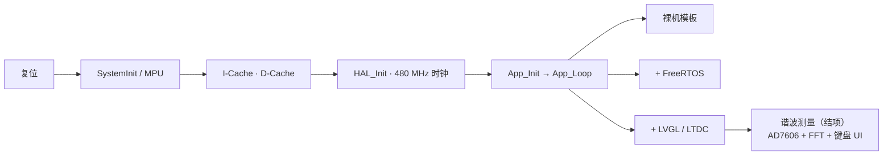

<div align="center">

# STM32H7 工程集（STM32H743）

**480 MHz + SDRAM + LTDC：裸机、FreeRTOS、LVGL 三套模板，加一个跑通的谐波测量结项工程**


[快速开始](#3-快速开始) · [H7 特有坑](#4-关键注意点h7-特有) · [全部仓库索引](https://github.com/xhtfps/xhtfps)

</div>

## 为什么单开 H7 一摊

H7 和 F4 不是一个写法：D-Cache 一开，DMA 缓冲区不对齐就出“数据偶尔错”；SDRAM 没配好，LTDC 直接黑屏。这个仓库的价值不在模板本身，而在**把 H7 特有的坑写在模板旁边**，让换屏、开 Cache、加 FreeRTOS 这几步有参照。

## 亮点

- **三套模板同源**：裸机 → FreeRTOS → LVGL 逐级加装，哪一层出问题就退回上一层，定位范围立刻缩小。
- **LTDC 换屏参照**：AT070TN83（800×480 RGB888）的时序、 GPIO、显存配置集中在一处，换屏照改。
- **Cache 一致性写进正文**：DMA/SDRAM 缓冲区的 Clean/Invalidate 做法与失败现象成对出现。
- **有结项工程兜底**：`谐波测量（结项）` 是 AD7606 八通道 + FFT + 4×4 键盘的真实整机，不是空模板。

## 结构



## 1. 目录一览

| 目录 | 内容 |
| --- | --- |
| `工程模板_裸机/` | 通用裸机模板：`App/` 业务层 + `Core/` 初始化 + `Drivers/`（CMSIS、HAL、User BSP），Keil 入口 `MDK-ARM/H7_Generic_Template.uvprojx` |
| `工程模板_freertos/` | 在裸机模板基础上接入 FreeRTOS |
| `工程模板_lvgl/` | 在裸机模板基础上接入 LVGL + LTDC 显示 |
| `5.LTDC液晶驱动-基于AT070TN83/` | 7 寸 AT070TN83 屏的 LTDC/DMA2D + 触摸驱动，改屏时参照此目录 |
| `谐波测量（结项）/` | AD7606 八通道采样 + FFT 谐波分析 + 4x4 键盘/UI（已结项） |

## 2. 软硬件环境

| 项 | 要求 |
| --- | --- |
| 开发板 | STM32H743 系列（工程默认 H743IIT6），板载 SDRAM + LTDC 接口 |
| 屏幕 | AT070TN83（800×480，RGB888 并口） |
| IDE | Keil MDK-ARM 5.36+，器件包 `Keil.STM32H7xx_DFP` |
| 调试器 | J-Link / ST-Link（SWD） |
| 串口 | USART1，115200 |

## 3. 快速开始

1. Keil 打开 `工程模板_裸机/MDK-ARM/H7_Generic_Template.uvprojx`。
2. `Rebuild all target files`，首次全编译。
3. 按实际板卡核对 `Core/Src/main.c` 中的时钟树、SDRAM 参数与外设时钟。
4. `Flash → Download` 烧录，复位后应看到 LED 心跳与串口启动打印。

默认初始化链：

```text
复位 → SystemInit → MPU → I-Cache/D-Cache → HAL_Init
     → 480 MHz 时钟 → App_Init → App_Loop
```

新增业务：业务代码放 `App/`，硬件封装放 `Drivers/User/`，不要直接在 HAL 驱动里写业务。

## 4. 关键注意点（H7 特有）

- **Cache 一致性**：D-Cache 打开后，DMA/SDRAM 缓冲区必须放在合适 SRAM 区域并做 Clean/Invalidate，否则会出现“数据偶尔错”。
- **SDRAM**：没有外扩 SDRAM 时，在 `Core/Inc/main.h` 关闭对应宏，并从 FMC 初始化中移除。
- **LTDC 换屏**：分辨率、时序、像素格式、GPIO 都要改；`Drivers/User/lcd_*.c` 是 AT070TN83 的参数，换屏需整体替换。
- **4x4 矩阵键盘**：行 `PB13/PB15/PD13/PE2`，列 `PB12/PB14/PB2/PD11`；方向反了改 `matrix_keypad.h` 里 `KEYPAD_ROW_REVERSE` / `KEYPAD_COL_REVERSE` / `KEYPAD_FIRST_GROUP_IS_ROWS`。

## 5. 常见问题

- **下载后无显示**：先确认 LTDC 时钟（`LTDC` 像素时钟）与 SDRAM 是否初始化成功，可用串口打印 `HAL_LTDC_Init` 返回值定位。
- **HardFault**：多为 MPU 配置或 Cache 关闭顺序问题，先关 D-Cache 验证。
- **LVGL 花屏**：显存对齐与 stride 不匹配，检查 `lv_conf.h` 的颜色格式和缓冲区大小。

## 6. 维护说明

- 排除清单见 [`EXCLUDED_MANIFEST.csv`](EXCLUDED_MANIFEST.csv)。
- `谐波测量（结项）` 的业务代码（AD7606、FFT、UI）**没有**并入通用模板，需要时从该目录整块取用。
- 第三方库与屏幕手册版权归原作者，仅作学习参考。
## 路线图

- [x] 裸机 / FreeRTOS / LVGL 三套模板与 LTDC 驱动入库
- [x] 谐波测量工程结项，UI 与算法分层
- [ ] 补一份 SDRAM 带宽与 LTDC 刷屏帧率的实测数据
- [ ] 把 `谐波测量` 的 AD7606 驱动抽到 `bsp-libs`

## 参与与反馈

- 遇到问题请走 [Issue 模板](.github/ISSUE_TEMPLATE)，注明是否开 Cache、是否接 SDRAM。
- 提 PR 前先读 [CONTRIBUTING.md](CONTRIBUTING.md)；安全问题按 [SECURITY.md](SECURITY.md) 私下反馈。
- 如果这个仓库帮你省过时间，点个 ⭐ 是最省事的支持。

## 许可证

本仓自写代码以 [MIT](LICENSE) 分发；ST HAL、LVGL、FreeRTOS 与屏幕手册版权归各自作者。
